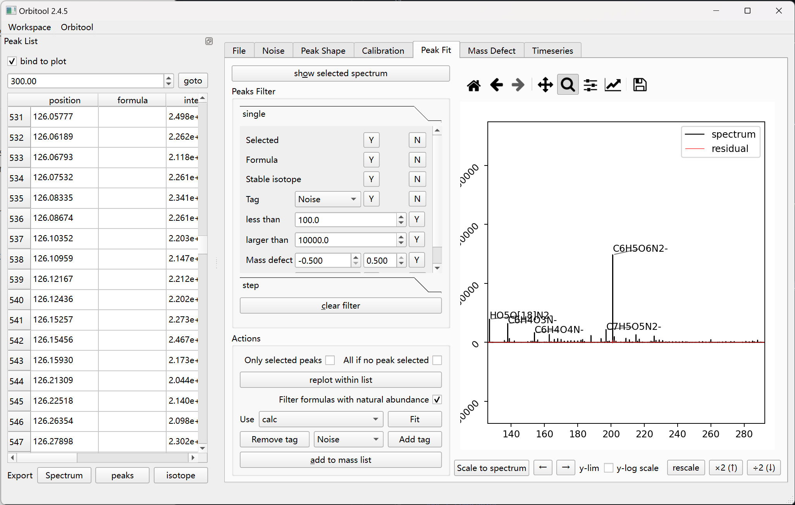

# Peak Fit Tab

Fit peaks and manage the fitted peaks shown in the [Peak List](dockers.md).

- **show selected spectrum** (`Alt + O`) plots the spectrum for the selected
  peak. Requires a denoised and calibrated spectrum, and a peak shape function
  set in the [Peak Shape tab](peak-shape.md); otherwise Orbitool shows a prompt
  instead of plotting.
- **Peaks Filter** hides peaks that don't match a condition. Filters overlay
  (a peak must pass all active ones). Clear them with **clear filter**
  (`Alt + C`). Conditions include:
  - **Y**/**N** toggles for formula, stable isotope, tag, mass defect, has-group
    (`NO3-` in the example), and intensity less-than / larger-than bounds.
  - **All if no peak selected** — apply an action to every displayed peak when
    nothing is selected.
- **Actions** apply to every peak currently shown in the Peak List docker.
  **Fit** runs the fit. If Peak Fit windows are open, Orbitool asks to close
  them first; closing discards their uncommitted edits. **Filter formulas with
  natural abundance** removes isotope peaks that don't match the natural
  distribution after fitting. **add to mass list** (`Alt + A`) and **Remove
  tag** (`Alt + R`) are bulk operations. **mass defect** opens the [Mass Defect
  window](mass-defect.md) for the peaks shown now.
- **step** — build a series by repeatedly adding a **Group+** (`HO2`) then
  subtracting a **Group-**; **step according to mass** steps by mass instead of
  formula. **Step range** and `tolerance(ppm)` bound the search.
- The plot and the Peak List are **bound** together; untick **bind to plot** to
  navigate them independently.

## Peak tags

A peak can carry a tag. Available tags:

- **Noise** — the peak is noise.
- **Done** — the peak has been handled.
- **Fail** — the fit failed; Orbitool adds this automatically when a fit fails.

## Peak List interactions

- Rows are selected as whole rows; Ctrl/Shift extends the selection.
- **Double-click** a peak to open its **Peak Fit window**; type a mass to jump to
  the nearest peak.
- **Right-click** a peak and choose **Jump to peak** to center the plot on it
  (±5 m/z) and switch to this tab.
- **Export** the spectrum, peaks, or isotope data from the
  [Peak List docker](dockers.md).

## Peak Fit window

Double-click a Peak List row to open the window for its segment. The title is
`Peak Fit - <mz> - <formula>`; `<formula>` is the segment's saved assignment
(several are comma-separated) and is omitted when there is none.

- Left: the segment's mz/intensity table, **peak num**, and **Re-fit**.
- Right: the show toggles and plot, then the Peaks table with **Edit selected
  peak's formula** and a change summary, then **Close** / **Save**.
- `formula` is the saved assignment. The `new formula` column appears only when
  a formula actually changes, and shows the uncommitted edit.
- Peak rows are selected as whole rows; Ctrl/Shift selects several. **Edit
  selected peak's formula** (or double-clicking a row) opens the formula result
  window for the current row.
- The summary under the table lists what changed: peak count, positions,
  intensities, formulas. **Save** is disabled while nothing has changed.
- **Save** commits the whole segment — re-fit count, positions, intensities and
  formulas. **Close** discards the uncommitted edits.

### Formula result window

Opened from a Peak Fit window, the window is bound to the selected peak: the
title shows the m/z, the input is read-only, and **Calc** regenerates candidates
after you change formula settings. Both tables select whole rows;
**Show actual distribution of selected formula** (or double-clicking a result
row) plots the isotope distribution. **Edit selected peak's formula** (or
double-clicking an isotope row) writes that formula back to the peak. **Delete
formula** clears the peak's assignment; **Use selected formula** replaces it with
the selected candidates; **Close** leaves it unchanged.

The formula window opened from the menu is a calculator with no peak to accept
into, so only **Close** is shown.

## Shortcuts

| Key | Action |
| --- | --- |
| `Alt + O` | Show selected spectrum |
| `Alt + C` | Clear filter |
| `Alt + R` | Remove tag |
| `Alt + A` | Add to mass list |
| `←` / `→` | Pan the plot horizontally |
| `↑` / `↓` | Scale the plot y-axis (`×2` / `÷2`) |
